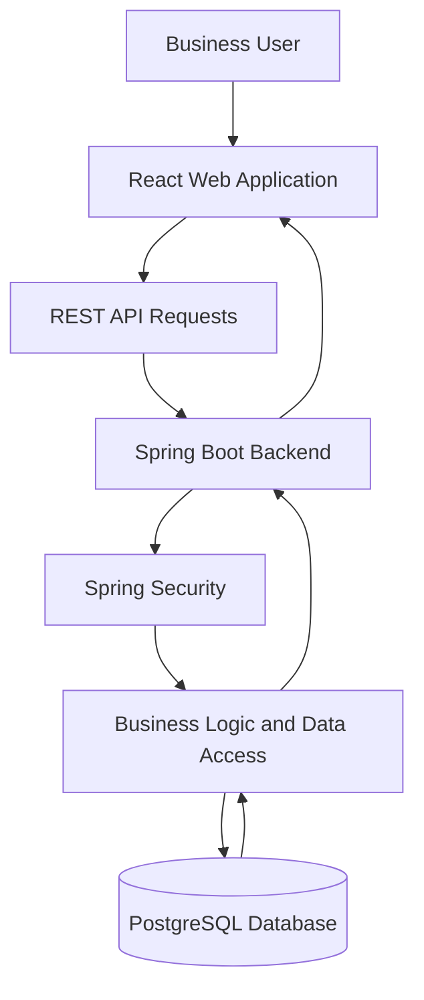
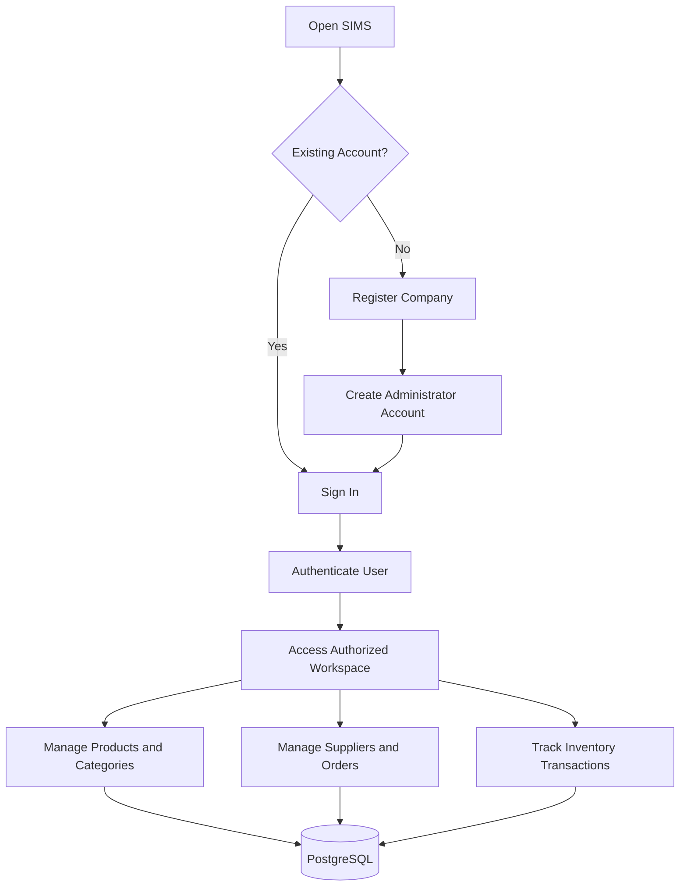

# SIMS — Smart Inventory Management System

<p align="center">
  
  
  
  
</p>

<h3 align="center">
  A Centralized Inventory Management Platform for Modern Businesses
</h3>

<p align="center">
  Product Management • Stock Tracking • Purchase & Sales Management • Company Workspaces • Role-Based Access Control
</p>

<p align="center">
  <a href="https://stockwise-inventory-management-1mx3.onrender.com">
    
  </a>
  <a href="https://github.com/bandhav100/StockWise-Inventory-Management">
    
  </a>
</p>

---

## Overview

**SIMS (Smart Inventory Management System)** is a web-based application designed to simplify inventory operations by providing businesses with a centralized platform to manage products, categories, suppliers, purchases, sales, and stock movements.

The system enables businesses to maintain organized inventory records, track changes in stock quantities, manage purchase and sales orders, and configure company-specific inventory settings.

SIMS supports separate company workspaces with administrator accounts and role-based access control. Its backend exposes REST APIs, while PostgreSQL stores the application's business data.

The goal is to improve inventory visibility, reduce manual recordkeeping, and make everyday stock management more organized and efficient.

## Live Application

| Component | Link |
|---|---|
| SIMS Web Application | [Open Live Demo](https://stockwise-inventory-management-1mx3.onrender.com) |
| Backend Service | [Open Backend on Render](https://stockwise-inventory-backend.onrender.com) |
| Source Code | [GitHub Repository](https://github.com/bandhav100/StockWise-Inventory-Management) |

> Deployment note: The live application may occasionally be unavailable during deployment or troubleshooting. Successful deployment does not by itself guarantee that every feature is operational.

---

## Technology Stack

<p align="center">
  <b>Application Stack</b>
</p>

<p align="center">
  
  
  
  
  
  
  
  
</p>

<p align="center">
  <b>Development & Deployment</b>
</p>

<p align="center">
  
  
  
  
</p>

| Layer | Technology | Purpose |
|---|---|---|
| Frontend | React | User interface and interactive screens |
| Frontend tooling | Vite | Development server and frontend build |
| Backend | Java 21, Spring Boot 3 | Business logic and REST API endpoints |
| Security | Spring Security | Authentication and authorization |
| Data access | Spring Data JPA / Hibernate | Database persistence and ORM |
| Database | PostgreSQL | Persistent business and inventory data |
| Schema management | Flyway | Versioned database migrations |
| Build | Maven | Backend dependency management and build |
| Deployment | Render | Hosting the frontend, backend, and database |
| Version control | Git and GitHub | Source control and collaboration |

---

## Key Features

### 1. Company Workspace Management

- Register a company and establish its inventory workspace.
- Associate an administrator account with the company.
- Maintain company-specific inventory data and settings.
- Organize business operations within the appropriate company context.

### 2. Authentication and Authorization

- Company registration and administrator account creation.
- Login using supported username or email credentials.
- Password hashing for secure password storage.
- Role-based access control for authorized operations.
- Active-account status and company association.

### 3. Product Management

- Maintain product information and inventory records.
- Organize products by category.
- Associate products with the relevant company.
- Support inventory operations using product records.

### 4. Category Management

- Maintain product categories.
- Organize inventory into meaningful groups.
- Improve product organization and retrieval.

### 5. Supplier Management

- Maintain supplier information.
- Associate suppliers with purchasing operations.
- Keep supplier records organized for business use.

### 6. Purchase Order Management

- Create and manage purchase orders.
- Maintain individual purchase order items.
- Organize purchasing records for inventory replenishment.

### 7. Sales Order Management

- Maintain sales orders and their associated items.
- Record sales-related inventory activity.
- Keep sales operations connected to inventory records.

### 8. Inventory Transactions

- Maintain records of inventory movements.
- Track stock-related operations.
- Keep an organized history of inventory transactions.

### 9. Stock Adjustments

- Record inventory corrections.
- Maintain stock adjustment records.
- Support inventory reconciliation workflows.

### 10. Company-Specific Settings

The database supports settings such as:

- Default reorder threshold.
- Low-stock and out-of-stock alerts.
- Negative-stock policy.
- Purchase approval requirements.
- Currency and timezone.
- Company contact information.

The availability of individual settings in the user interface depends on the implemented application screens.

---

## System Architecture

SIMS follows a frontend–backend–database architecture.



### Architecture Components

**Frontend:** Provides the screens used to register companies, authenticate users, and perform inventory operations.

**Backend:** Processes API requests, applies business rules, handles authentication, and communicates with the database.

**Security layer:** Enforces the application's authentication and authorization rules.

**Database:** Stores company records, users, products, suppliers, orders, inventory transactions, and settings.

---

## Database Design

The PostgreSQL database contains tables for the following entities:

| Table | Purpose |
|---|---|
| `companies` | Company workspace information |
| `users` | User accounts, roles, and company associations |
| `products` | Product and inventory information |
| `categories` | Product categories |
| `suppliers` | Supplier records |
| `purchase_orders` | Purchase order headers |
| `purchase_order_items` | Items belonging to purchase orders |
| `sales_orders` | Sales order headers |
| `sales_order_items` | Items belonging to sales orders |
| `inventory_transactions` | Inventory movement records |
| `stock_adjustments` | Stock adjustment records |
| `system_settings` | Company-specific configuration |
| `flyway_schema_history` | Database migration history |

The exact relationships, constraints, and column definitions are determined by the application's entity mappings and database migrations.

---

## Project Workflow



This illustrates the intended business workflow; individual screens and permissions depend on the implemented application.

---

## Getting Started

### Prerequisites

Install the following tools:

- Java Development Kit (JDK) 21.
- Node.js and npm.
- PostgreSQL, if running the database locally.
- Git.
- Maven, or the Maven Wrapper included with the backend project.

### 1. Clone the Repository

```bash
git clone https://github.com/bandhav100/StockWise-Inventory-Management.git
cd StockWise-Inventory-Management
```

### 2. Configure PostgreSQL

Create a PostgreSQL database for local development.

Configure the backend with the appropriate database connection variables:

```properties
spring.datasource.url=${SPRING_DATASOURCE_URL}
spring.datasource.username=${SPRING_DATASOURCE_USERNAME}
spring.datasource.password=${SPRING_DATASOURCE_PASSWORD}
```

Set these environment variables in your local environment. Use the actual configuration expected by your project.

Never commit real database passwords, API secrets, or authentication tokens to GitHub.

### 3. Start the Backend

Open a terminal in the backend directory:

```powershell
cd backend
.\mvnw.cmd spring-boot:run
```

On Linux or macOS:

```bash
cd backend
./mvnw spring-boot:run
```

The backend port is determined by the application's configuration.

### 4. Start the Frontend

Open another terminal:

```bash
cd frontend
npm install
npm run dev
```

Open the local URL printed by Vite.

> The commands above assume the repository contains `backend` and `frontend` directories. Adjust the paths if your repository uses a different layout.

---

## Environment Configuration

The backend may require the following configuration:

| Variable | Purpose |
|---|---|
| `SPRING_DATASOURCE_URL` | PostgreSQL JDBC connection URL |
| `SPRING_DATASOURCE_USERNAME` | Database username |
| `SPRING_DATASOURCE_PASSWORD` | Database password |
| `SPRING_PROFILES_ACTIVE` | Optional Spring profile, if configured |

Configure the frontend API base URL using the environment variable expected by its codebase. For Vite projects, frontend variables exposed to the browser generally use the `VITE_` prefix.

Example placeholder:

```env
VITE_API_BASE_URL=https://your-backend-service.example.com/api/v1
```

Use the actual variable name and API base path expected by your frontend implementation.

---

## Deployment

The project uses Render for deployment.

### Deployment Components

1. **Frontend service:** Hosts the React application.
2. **Backend service:** Hosts the Spring Boot REST API.
3. **PostgreSQL database:** Stores persistent application data.

### Deployment Checklist

- Configure the correct PostgreSQL connection details.
- Configure environment variables in Render.
- Ensure the backend builds and starts successfully.
- Configure CORS to allow the deployed frontend origin.
- Verify authentication, CSRF, and authorization behavior.
- Confirm that the frontend points to the correct backend API.
- Test registration, login, and inventory operations after deployment.

### Deployment URLs

- Frontend: https://stockwise-inventory-management-1mx3.onrender.com
- Backend: https://stockwise-inventory-backend.onrender.com

A successful deployment should be followed by functional testing of the actual application endpoints.

---

## Security Considerations

- Store passwords as secure hashes, never plaintext.
- Keep database credentials in environment variables.
- Restrict API access according to the application's authorization rules.
- Configure CORS for explicitly approved frontend origins.
- Preserve appropriate CSRF protections for the selected authentication mechanism.
- Never expose database credentials, JWT secrets, or private keys in source control.
- Validate incoming data and handle errors safely.
- Ensure that company-specific data is accessible only to appropriately authorized users.

---

## Testing and Quality Assurance

Recommended checks before releasing a new version:

| Area | Example test |
|---|---|
| Registration | A valid company registration creates the expected records |
| Login | Valid credentials authenticate successfully |
| Authentication | Invalid credentials are rejected |
| Authorization | Unauthorized users cannot access protected operations |
| Product management | Product creation and updates persist correctly |
| Categories | Category operations behave as expected |
| Suppliers | Supplier records can be managed |
| Purchasing | Purchase orders and items are stored correctly |
| Sales | Sales orders and items are stored correctly |
| Inventory | Stock transactions and adjustments are recorded |
| Database | Data persists across application restarts |
| Deployment | Frontend and backend communicate successfully |

These are recommended test cases, not a claim that every test has already passed.

---

## Future Enhancements

Potential improvements include:

- Advanced inventory dashboards and analytics.
- Automated reorder recommendations.
- Barcode and QR-code scanning.
- Inventory forecasting and demand analysis.
- Exportable inventory, sales, and purchase reports.
- Email or in-app notifications for stock alerts.
- Expanded audit trails and reporting.
- Automated CI/CD and integration testing.

---

## Author

**Bandhav Arugonda**

GitHub: [@bandhav100](https://github.com/bandhav100)

Project: [StockWise-Inventory-Management](https://github.com/bandhav100/StockWise-Inventory-Management)

---

<p align="center">
  Built to make inventory operations more organized, accessible, and efficient.
</p>

<p align="center">
  <b>SIMS — Smart Inventory Management System</b>
</p>
